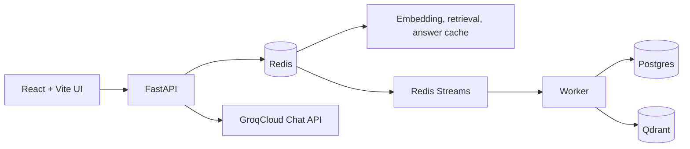

# RAG Workspace

Local-first agentic RAG workspace with FastAPI, Redis Streams, Postgres, Qdrant, GroqCloud, and a React/Vite UI.

## Run Locally

Install Docker Desktop first, then from this folder:

```powershell
Copy-Item .env.example .env
# Add GROQ_API_KEY to .env for GroqCloud answers
docker compose up --build
```

Open the UI at `http://localhost:5173`.

The app still boots without `GROQ_API_KEY`; ingestion and indexing work, and chat returns a clear API-key-required state. GroqCloud API calls require internet access and a valid GroqCloud API key.

## Local Architecture



Redis Streams are the default queue backend for local development. Kafka lives in `docker-compose.distributed.yml` for future production-scale experiments, not as a local prerequisite.

## Product Surface

- Chat: grounded answers, clickable citation chunks, confidence, and safe activity trace.
- Sources: upload files, paste text, watch status, refresh, and delete.
- Quality: visible limitations and grounding contract.

Anonymous workspaces are isolated by a signed cookie. Documents, chunks, vectors, sessions, cache keys, and deletes are scoped to the workspace.

## Grounding Contract

The server uses GroqCloud through its OpenAI-compatible Chat Completions API. The model receives one local tool: `search_knowledge_base`. That tool can only search the current workspace's indexed chunks.

Answers are normalized to one of:

- `answered`
- `insufficient_evidence`
- `refusal`

The server validates citations against retrieved chunk IDs before returning the answer.

## Cache Strategy

- Embeddings: model version plus normalized text hash.
- Retrieval: workspace, knowledge revision, question, filters, and `top_k`.
- Answers: workspace, knowledge revision, model, prompt version, bounded history hash, and question.
- Knowledge revision increments after enqueue, successful indexing, and deletion.

## Optional Distributed Profile

```powershell
docker compose -f docker-compose.yml -f docker-compose.distributed.yml up --build
```

This starts Kafka and an OTel collector, but the current local worker defaults to Redis Streams.

## Notes

- First Docker run is slower because images and the embedding model download.
- Keep secrets only in `.env`; never put `GROQ_API_KEY` in frontend code.
- GroqCloud is different from xAI/Grok; use keys from https://console.groq.com/keys.
- If you already have old Docker volumes from the earlier schema, run with fresh volumes during development.
